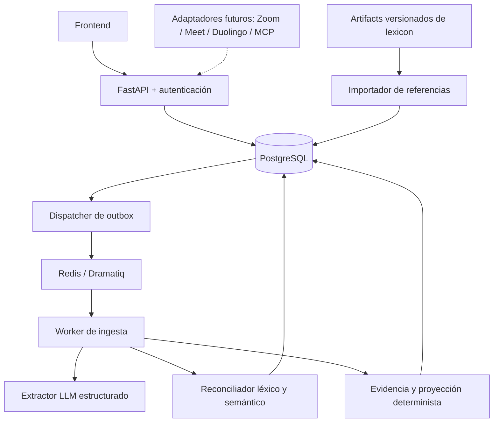

# Propuesta de backend de LinguaTrack

Estado: diseño de referencia aprobado para iniciar el desarrollo. Fecha: 20 de noviembre de 2026.

Actualización: se implementó un MVP local con OpenAI y sin autenticación por solicitud del usuario. El [README del backend](../apps/backend/README.md) identifica las funciones disponibles, cómo probar Swagger y las partes de este diseño que siguen pendientes. La autenticación OIDC y la recuperación semántica no forman parte de la entrega local inicial.

El idioma objetivo proviene del track. Las sesiones admiten `bridge_languages` para explicaciones/traducciones y cada run conserva ese contexto; omitirlo permite inferirlo. La mezcla de idiomas es normal y no crea evidencia para los idiomas puente. Reprocesar permite declarar o cambiar el contexto sin editar la clase original.

## 1. Recomendación y alcance

Construir un monolito modular en `apps/backend/`: Python 3.12+, FastAPI, Pydantic v2, SQLAlchemy 2, Alembic y PostgreSQL con pgvector. Ejecutar API y worker como procesos separados del mismo código. Redis y Dramatiq transportan trabajos; PostgreSQL conserva el estado durable. El frontend React/Vite será otra aplicación.

El MVP permitirá registrar idiomas por usuario, enviar una clase en texto, consultar su procesamiento, revisar conceptos nuevos/revisitados y corregir extracciones. Preparará contratos para Zoom, Meet, Duolingo y MCP, sin OAuth, webhooks, scraping ni conexiones reales a esos servicios.

La unidad principal no será una lista de palabras aprendidas. Será una relación **usuario → idioma → concepto → evidencia → estado derivado**. La interfaz podrá mostrar un pool de vocabulario, distinguiendo encontrado, practicado y demostrado. «Nuevo» significa nuevo en el historial registrado, no necesariamente desconocido por la persona.

Decisiones de simplificación:

- Un grafo relacional en PostgreSQL, sin otra base de grafos.
- Historial inmutable para observaciones y correcciones; CRUD convencional para preferencias y trabajos. No event sourcing para toda la aplicación.
- Un extractor LLM con salida estructurada y un orquestador explícito. LangChain es opcional; LangGraph queda para flujos con bifurcaciones y estado que lo justifiquen.
- Contadores y estados explicables en el MVP, sin porcentajes de dominio ni CEFR estimado sin calibración.
- Referencias lingüísticas versionadas y conceptos provisionales privados. Una clase nunca publica automáticamente texto personal en el diccionario compartido.

## 2. Inspección del repositorio

`apps/` está reservado y no contiene backend, frontend, autenticación ni infraestructura. `packages/lexicon/` ya implementa adquisición, normalización, validación y builds reproducibles, con esquemas JSON y CI. Mantener sus dependencias separadas.

El contrato actual está en `packages/lexicon/docs/SCHEMA.md`: `entries`, `forms`, `senses`, `morphology`, `relations`, `frequency` y `cefr`. Son **afirmaciones de fuentes**, no un diccionario universal reconciliado. Los IDs dependen del snapshot y no sirven como claves permanentes de conocimiento del usuario. Variantes `pt`, `pt-BR` y `pt-PT` permanecen distintas; las formas no se colapsan por stemming.

La validación existente informa datos reales de formas/frecuencia/morfología y anchors limitados, pero no un diccionario completo ni una capa real de sentidos para todos los idiomas. Los ejemplos sintéticos no son material pedagógico ni cobertura de producción. El backend debe funcionar cuando falten sentidos, frecuencia o CEFR.

El importador consumirá artifacts y manifest, verificará checksums, versión del esquema, estado de fuentes y restricciones de licencia; conservará atribución y procedencia por afirmación. No importará datos raw ni ejecutará un build de lexicon durante una petición HTTP. No reinterpretará `import_fidelity_heuristic` como certeza lingüística.

## 3. Componentes y flujo



Módulos propuestos: `identity`, `languages`, `reference`, `ingestion`, `extraction`, `resolution`, `evidence`, `knowledge`, `integrations`, `jobs` y `api`. Cada uno expone servicios; los routers no contienen reglas de dominio. API y workers usan las mismas transacciones y reglas. Cada trabajo transporta IDs, nunca el texto completo.

Autenticación: validar tokens OIDC mediante issuer, audience, expiración y claves del proveedor; vincular `(issuer, subject)` a un UUID interno. No aceptar `user_id` suministrado por el cliente como identidad. Proveedor por elegir; no construir almacenamiento de contraseñas en el MVP. Las pruebas usan un verificador inyectable y producción no admite suplantación mediante cabeceras de desarrollo.

## 4. Modelo y esquema PostgreSQL propuesto

Claves internas UUID, fechas `timestamptz` UTC y texto original preservado. JSONB sirve para payloads externos y features variables, no para sustituir claves foráneas. A continuación se describen tablas, no migraciones ejecutables.

### Identidad y referencias

| Tabla | Campos y restricciones principales |
|---|---|
| `users` | `id`, `issuer`, `subject`, timestamps; UNIQUE(issuer, subject) |
| `languages` | `tag` PK BCP-47, `base_tag` FK, nombre, versión de normalizador; coincide con el catálogo admitido |
| `user_languages` | `id`, `user_id`, `language_tag`, preferencias; UNIQUE(user_id, language_tag), UNIQUE(user_id, id) |
| `reference_builds` | `id`, digest único del manifest, versión de schema/pipeline, estado staged/active/failed, manifest y atribución |
| `reference_assertions` | `id`, build FK, tipo, assertion ID de origen, payload y provenance; UNIQUE(build_id, tipo, source_assertion_id) |
| `concepts` | `id` estable, `language_tag`, tipo lexeme/form/sense/construction/competency, `owner_user_id` nullable, estado provisional/curated/retired |
| `lexemes` | concept PK/FK, lemma original, clave NFC, clave de búsqueda, UPOS, distinción de homógrafo/etimología |
| `forms` | concept PK/FK, lexeme FK, superficie, features JSONB y etiquetas originales; varias interpretaciones por superficie |
| `senses` | concept PK/FK, lexeme FK, glosa, idioma de glosa, etiquetas; los sentidos de diferentes fuentes no se fusionan implícitamente |
| `constructions` | concept PK/FK, patrón, descripción y restricciones; sin depender de una sola palabra |
| `competencies` | concept PK/FK, descriptor y dimensión; anchors externos independientes |
| `concept_relations` | sujeto/objeto FK, tipo inflection_of/derivation_of/synonym/contrast/requires/etc., procedencia; relaciones ambiguas quedan como assertions sin target canónico |
| `concept_assertions` | enlace assertion ↔ concepto, decisión/método/versión de reconciliación; admite múltiples fuentes y alineaciones pendientes |
| `concept_redirects` | concepto retirado → destino, versión y motivo; sin ciclos y con historial, para merges revisados |
| `frequency_observations` | assertion FK, corpus, unidad, texto, POS nullable, rango, count y denominador nullable; enlace canónico opcional y justificado |
| `proficiency_anchors` | assertion FK, nivel, método, alcance, enlace canónico opcional; conserva conflictos y licencias |

Restricción transversal: las tablas de subtipo deben coincidir con `concepts.kind` y lenguaje; validación transaccional y triggers diferidos donde una FK no baste. Las referencias entre conceptos privados solo pueden apuntar al mismo propietario o a conceptos públicos. Una referencia pública no puede apuntar a un concepto privado.

No imponer UNIQUE(language, lemma): rompería homógrafos y polisemia. Indexar `(language_tag, search_key, upos)` para candidatos. Las equivalencias revisadas y los mapas de origen son las que evitan recrear entidades. Las decisiones sobre conceptos compartidos no deben cambiar silenciosamente al actualizar diccionarios.

### Aprendizaje, procesamiento y proyecciones

| Tabla | Campos y restricciones principales |
|---|---|
| `learning_sessions` | `id`, `user_id`, `user_language_id`, plataforma, fecha de actividad opcional, fecha de recepción, metadatos; UNIQUE(user_id, id) |
| `session_contents` | `id`, `user_id`, session FK, revisión, texto original y hash; UNIQUE(session_id, revision); cada revisión es inmutable |
| `ingestion_requests` | `id`, usuario, scope, idempotency key, request hash, session FK; UNIQUE(user_id, scope, idempotency_key) |
| `processing_runs` | `id`, usuario, sesión/content FK, run padre, extractor/modelo/prompt/schema/resolver/policy versions, build de referencia fijado, estado y resultados persistidos |
| `extracted_items` | `id`, usuario, run FK, índice estable dentro del resultado persistido, texto, span, tipo, lengua, candidato, confianza y base; UNIQUE(run_id, item_index) |
| `resolution_decisions` | `id`, usuario, item FK, candidatos, decisión, razón, versión, actor; append-only |
| `learning_observations` | `id`, usuario, sesión, run, concepto, activity key, dimensión, tipo, resultado, asistencia, timestamp, span/cita, atribución de actor, confianza y provenance |
| `evidence_amendments` | `id`, usuario, observation/item FK, retract/replace/resolve, motivo, actor, comando idempotente; append-only |
| `session_publications` | `id`, usuario, sesión, run aceptado, revisión anterior, fecha y versión; append-only; puntero actual actualizado bajo lock |
| `user_knowledge_state` | usuario, user_language, concepto, dimensión, versión de proyector; contadores, primera/última evidencia, último resultado y revisión de entrada; UNIQUE(user_language_id, concept_id, dimension, projector_version) |
| `knowledge_inferences` | usuario, concepto/dimensión destino, soporte, modelo/versión, valor y significado de incertidumbre; separado de demostraciones; diferido |
| `outbox` | `id`, usuario si corresponde, tipo, aggregate ID/revisión, payload mínimo, published_at y reintentos; UNIQUE(tipo, aggregate_id, revision) |
| `job_attempts` | run FK, intento, lease/fencing token, heartbeat, inicio/fin y error sanitizado |
| `integration_connections` | usuario, provider, estado, referencia a secreto y cursor; reservada para futuras conexiones |
| `external_deliveries` | conexión FK, external event ID, payload hash y session FK; UNIQUE(connection_id, external_event_id); futura |

Toda tabla privada tiene `user_id`. FKs compuestas `(user_id, session_id)` y `(user_id, user_language_id)` impiden relaciones cruzadas, incluso si hay un error de servicio. Aplicar controles equivalentes para runs, observaciones y enmiendas. Validar que el idioma del concepto sea compatible con el track: toda herencia de variante debe estar declarada, nunca implícita por prefijo.

Índices B-tree: `(user_id, created_at, id)` en sesiones; `(user_id, status, created_at)` en runs; `(user_id, concept_id, occurred_at, id)` y `(session_id, run_id)` en observaciones; índices de todas las FKs de alto uso; índice parcial de outbox pendiente y de jobs recuperables. Checks para enums, spans `0 <= start < end`, hashes y confianzas dentro de rango. La confianza incluye siempre su interpretación; no es automáticamente una probabilidad calibrada.

RLS como defensa adicional en todas las tablas privadas: `USING` y `WITH CHECK` por identidad transaccional, usando `SET LOCAL` también en workers. API sin privilegios de propietario, superusuario ni BYPASSRLS; roles separados para migraciones e importación. PostgreSQL documenta que propietarios normalmente omiten RLS; usar FORCE donde corresponda y probarlo con roles reales [1]. No configurar el tenant globalmente sobre una conexión del pool.

El rol de aplicación no modifica ni borra evidencia publicada: inserta enmiendas. El borrado de cuenta/contenido es una operación privilegiada explícita que elimina datos privados y derivados conforme a la política de retención; inmutabilidad de negocio no significa conservar datos personales para siempre. No exportar datos personales mediante el pipeline público.

## 5. Ingesta manual y extracción

1. `POST` autenticado con track, texto, fecha opcional e `Idempotency-Key`. Validar tamaño y pertenencia. La misma key y payload devuelve la misma sesión; payload diferente devuelve 409. El hash solo detecta repeticiones potenciales: no bloquea dos clases legítimamente iguales con keys distintas.
2. En una transacción guardar sesión, contenido, solicitud, run queued y outbox; responder 202 con IDs y URL de estado. Si Redis está caído la solicitud permanece durable y pendiente.
3. Dispatcher publica el run. Worker adquiere lease con fencing token; carga contenido y configuración fijada. No mantener transacciones ni locks durante llamadas al LLM.
4. Extractor devuelve JSON validado con Pydantic: conceptos, superficie/lemma sugerido, lengua, sentidos candidatos, construcciones, spans, actividad, resultado, asistencia y quién realizó la acción. Cada evidencia debe citar el input, no una explicación generada.
5. Verificar que cada cita y span corresponda al texto original. Offsets en índices de caracteres Unicode del string decodificado, intervalo `[start,end)`. La normalización se usa en copias de búsqueda; no altera offsets. Contenido que no respalda una afirmación produce `needs_review`, no evidencia inventada.
6. Reconciliar candidatos y persistir decisiones. Ambigüedades no bloquean conceptos claros. Distinguir salida inválida, ambigüedad lingüística y fallo de infraestructura.
7. Preparar evidencia y resumen del nuevo run. Bajo lock del track y sesión, validar lease/revisión esperada, publicar el run y reconstruir estados afectados de forma atómica. Reintentos no publican dos veces. La extracción se compara con el historial anterior a esa publicación.
8. Responder con nuevos en historial, revisitados, práctica, demostraciones e incertidumbres. El estado final puede ser `completed` con `review_required=true`; un fallo técnico es `failed` y nunca simula una clase vacía.

No extraer todas las palabras de la lengua explicativa como vocabulario estudiado. En una clase de malayo narrada en inglés, “today” no cuenta como inglés aprendido. Distinguir texto trabajado, instrucciones, ejemplos del profesor y producción del alumno. Una transcripción sin atribución fiable solo respalda exposición o evidencia pendiente, no producción independiente del estudiante.

Para textos extensos: dividir por límites conservando offsets absolutos, solapar contexto y deduplicar por actividad/span/concepto. Registrar extracción incompleta; no truncar silenciosamente. Límites iniciales de tamaño, presupuesto y timeout son configuración operativa a fijar con muestras reales.

### Ejemplo de las dos clases en malayo

| Clase | Resultado esperado |
|---|---|
| 1: “learned walaupun, terpaksa, sempat” | Tres lexemas nuevos en historial si no había evidencia anterior. Sentidos solo si la glosa y referencia permiten resolverlos. Exposición, sin demostrar dominio. |
| 1: “practiced using walaupun in concessive sentences” | Práctica declarada de walaupun/construcción concesiva; resultado y asistencia desconocidos. No inventar éxito ni un número de ejercicios. |
| 2: “reviewed walaupun” + “used it correctly without assistance” | Revisión y producción correcta independiente. Si ambas frases describen una actividad, un único intento con atributos; no sumar eventos de éxito artificialmente. Evidencia reportada por la nota, no evaluación verificada directamente. Modalidad speaking/writing desconocida si no se indica. |
| 2: “introduced meskipun as an alternative” | Nuevo en historial, exposición; relación de alternativa contextual con walaupun, sin fusionarlos. |
| 2: “difference between sempat and berpeluang” | sempat revisitado, berpeluang nuevo; práctica de contraste con resultado desconocido. |

La clase 2 tiene dos lexemas nuevos y dos revisitados en este ejemplo, sin contar construcciones como palabras. terpaksa conserva su estado. No se etiqueta ningún concepto como retenido o dominado por estas dos notas solamente. Una futura importación de historia anterior puede cambiar qué encuentro es el primero: el resumen debe identificar la revisión de historial con la que fue calculado.

## 6. Reconciliación híbrida

Pseudocódigo de diseño:

```text
resolver(item, usuario, idioma, build, resolver_version):
    validar idioma, tipo y acceso al concepto
    si trae ID canónico: verificar existencia, alcance y compatibilidad contextual
    buscar mapeos de origen revisados para este build
    recuperar candidatos por superficie/lemma NFC + POS + variante
    expandir por formas y análisis morfológicos respaldados
    recuperar sentidos compatibles con glosa y contexto
    si sigue ambiguo: agregar candidatos vectoriales filtrados
    aplicar reglas de incompatibilidad y evidencia de identidad
    si hay identidad inequívoca: guardar decisión enlazada con razones
    si LLM desambigua: solo puede seleccionar candidatos autorizados o abstenerse
    si la identidad sigue incierta: guardar candidatos y dejar pendiente
    si no hay candidato fiable: crear/reusar concepto provisional privado
```

Normalización versionada por idioma: NFC y trim; casefold como clave secundaria, preservando case y acentos. No eliminar diacríticos ni aplicar stemming universal. `left` puede ser forma de `leave` o un lexema distinto; `salgo` y `saliese` no son la misma competencia. En malayo, `ajar`, `belajar`, `mengajar`, `pelajar` y `pelajaran` pueden tener vínculos derivativos sin representar un único lexema aprendido.

Los vectores recuperan candidatos; no prueban identidad. `walaupun` y `meskipun` no se fusionan por cercanía. Sentidos ambiguos pueden quedar sin resolver mientras se registra exposición al lexema. No generar un sentido nuevo por cada aparición.

Para evitar duplicados concurrentes: lock transaccional por scope/idioma/tipo/clave de búsqueda, recuperar otra vez dentro del lock y crear solo si no existe equivalencia respaldada. Homógrafos admiten una distinción explícita. Items del mismo run con idéntico referente comparten concepto. Los provisionales inciertos pueden coexistir y reconciliarse después; es preferible un duplicado auditable a una fusión errónea. Cada promoción/merge tiene decisión revisada y exige reconstruir las proyecciones afectadas.

### Embeddings y pgvector

Tabla `embedding_models`: proveedor, modelo/revisión, dimensiones, métrica, idiomas y versión de plantilla. Tabla `concept_embeddings`: concept FK, model FK, content hash, idioma, clase de representación y vector; UNIQUE(concept_id, model_id, representation_kind, content_hash). Índices por modelo activo. Usar tablas/columnas `vector(d)` e índices separados para dimensiones distintas; no mezclar espacios aunque tengan la misma dimensión.

Priorizar embeddings de **sentidos** (lemma + POS + glosa + restricciones) y **construcciones**. El embedding de lemma es solo fallback cuando no existen sentidos. Formas se resuelven primero mediante morfología; no necesita cada inflexión un embedding propio. Los ejemplos contextuales privados, si luego se incorporan, viven en almacenamiento con scope del usuario, nunca en el índice público. No persistir embeddings de clases completas en el MVP.

Elegir un modelo multilingüe después de evaluarlo con en/es/pt/ms, especialmente malayo; la etiqueta “multilingüe” no garantiza cobertura. Consultas y documentos usan el mismo modelo y plantillas compatibles. Traducciones auxiliares no convierten conceptos entre idiomas en identidades. El proveedor LLM y el de embeddings se inyectan como adaptadores independientes.

Primero recuperación exacta B-tree; luego combinación de candidatos léxicos y semánticos, con razones por canal y ranking versionado. No hay un umbral universal de cosine similarity para auto-fusionar. Para pocos candidatos filtrados, búsqueda vectorial exacta. Para millones, HNSW con cosine (`vector_cosine_ops`) por modelo y, si las mediciones lo justifican, particiones por idioma o índices parciales. Metadatos idioma/tipo/scope no deben desaparecer de la consulta.

pgvector advierte que el filtrado de un índice aproximado puede dejar pocos resultados; ajustar `ef_search`, usar iterative scans en versiones compatibles y evaluar recall contra búsqueda exacta [2]. Medir p95, memoria del índice y recall por idioma; no particionar toda la base anticipadamente. Un vector de d dimensiones requiere aproximadamente 4d bytes para sus valores, antes de filas, metadatos e índices: presupuestar el número de sentidos y versiones, no solo lexemas.

Regeneración: nuevo modelo/plantilla/content hash genera embeddings en paralelo, se evalúa y se activa por configuración; los runs conservan la versión utilizada. Retirar versiones antiguas después de la ventana de auditoría. Nunca reinterpretar distancias de dos modelos como comparables.

## 7. Evidencia y proyección de conocimiento

Una observación identifica una actividad sobre un concepto. Tipos base: `exposure`, `review`, `recognition`, `recall_attempt`, `production_attempt` y `practice_unspecified`. Correctness (correct/incorrect/partial/unknown), assistance (none/hint/full/unknown), corrección del profesor y modalidad son atributos o anotaciones enlazadas al intento. `correct_response`, `assisted_response` e `independent_production` son vistas derivadas, no otros tres intentos.

Persistir: usuario, sesión, concepto, activity key, tiempo de actividad y tiempo de registro, span original, actor estudiante/profesor/desconocido, dimensión conocida o unspecified, procedencia, versiones, confianza y base. Separar `reported` de `directly_observed`. Una clase que dice “lo hicimos bien” no identifica automáticamente al alumno ni a cada palabra.

Idempotencia local: UNIQUE(run_id, activity_key, concept_id, dimension). El activity key proviene del resultado persistido y su anclaje, no de generar otra UUID cada vez. Reprocesamientos crean otro run, pero solo la publicación vigente de cada sesión contribuye. No deduplicar entre clases por palabra: son encuentros distintos. Si una misma actividad aparece replicada entre plataformas, usar su identidad externa cuando esté disponible; de otro modo marcar posible duplicado sin borrar evidencia por similitud textual.

`user_knowledge_state` se calcula sobre evidencia efectiva: runs publicados, decisiones aplicables y enmiendas vigentes. Guarda conteos de actividades distintas de exposición, práctica, aciertos independientes, aciertos asistidos y errores; fechas; resultado reciente; fuente de demostración y flags de revisión. Un intento correcto produce una unidad de práctica y una unidad en el subconjunto de aciertos, no dos prácticas. Las vistas de vocabulario agrupan lexemas y cuentan formas, sentidos y competencias por separado.

Dimensiones: vocabulario receptivo/productivo, lectura, escucha, escritura, habla, morfología, gramática y semántica. Son ejes relacionados, no sumables. Se actualizan solo las dimensiones respaldadas por la actividad; modalidad desconocida permanece unspecified. No propagar automáticamente un acierto de escritura a habla ni un sentido a todos los sentidos del lemma.

Estados explicables y señales independientes:

- **Primer encuentro registrado / exposición repetida:** fechas y conteo de actividades, sin inferencia de desconocimiento anterior.
- **Practicado:** hay intento o práctica explícita, aunque no se conozca el resultado.
- **Con demostración registrada:** al menos un desempeño correcto independiente respaldado; mostrar cuántos, cuándo y de qué fuente. No equivale a dominio estable.
- **Evidencia contradictoria:** mostrar errores y aciertos, sin ocultar ninguno detrás de un estado máximo.
- **Inferido:** separado y desactivado inicialmente; no convierte evidencia indirecta en demostración.
- **Retención:** requiere oportunidades posteriores separadas temporalmente; MVP muestra fechas/recalls posteriores sin afirmar una probabilidad de retención.
- **Insuficiente evidencia:** null/unknown para capacidad no evaluada; nunca cero de conocimiento.

Proyector puro, con versión de política y orden determinista `(occurred_at, recorded_at, id)`. Si falta fecha de actividad, usar recepción con indicador explícito. Reconstrucción desde cero debe producir el mismo estado. En el MVP recalcular conceptos afectados en vez de encadenar sumas/restas frágiles; ante correcciones, incluir tanto los conceptos previos como los nuevos. Proteger publicaciones concurrentes mediante lock por track y revisión esperada.

### Modelos futuros y transferencia

| Enfoque | Decisión y limitación |
|---|---|
| Contadores/reglas | MVP: transparentes y reproducibles; no son probabilidades de dominio. |
| Bayesian Knowledge Tracing | Evaluar cuando existan intentos por habilidad y datos para ajustar aprendizaje, slip y guess; no calibrar con simples menciones de clase. |
| Item Response Theory | Requiere ítems identificables, dificultad y suficientes respuestas comparables; útil para evaluaciones estructuradas, no texto libre arbitrario. |
| Modelos de olvido | Requieren resultados a distintos intervalos; exposición reciente por sí sola no valida retención. |
| Propagación en grafo | Priorizar diagnósticos o recomendaciones; relaciones semánticas no autorizan transferir dominio. |

Más adelante una relación inflection_of puede aportar un prior débil a reconocimiento de una forma, sin declarar producción correcta. Derivación, sinonimia y competencia gramatical tienen políticas distintas. Toda inferencia registra origen, versión y soporte; la frecuencia puede priorizar práctica, no demostrar habilidad. Comparar modelos con datos reservados y calibración por idioma/dimensión antes de mostrar probabilidades. Incertidumbre desconocida se expresa como tal, no como un intervalo estadístico inventado.

## 8. Roadmap lingüístico y progreso

Separar métricas: lexemas encontrados, sentidos alineados, conceptos practicados, desempeño observado, cobertura de referencias y cobertura de evaluación. Frecuencia ponderada solo dentro de un corpus identificado, con denominador válido y alineación compatible con su unidad. Sin denominador o con top-N truncado, mostrar cobertura de esa lista, no del idioma.

Los anchors CEFR conservan fuente, alcance, conflictos y vocabulario/gramática. Cobertura de una lista A2 no demuestra nivel A2. Lectura, escucha, interacción y producción requieren evaluaciones y descriptores apropiados. MVP no entrega un CEFR global ni un porcentaje de “idioma aprendido”.

Para malayo y otros idiomas con referencias limitadas: historial personal y conceptos provisionales primero; descriptores compartidos como organización, construcciones descubiertas con revisión y frecuencia auditada donde exista. Mostrar qué partes carecen de referencia. No derivar niveles desde rangos de frecuencia ni copiar umbrales ingleses. El roadmap inicial recomienda revisitar conceptos y verificar habilidades sin prometer una certificación.

## 9. API propuesta

Todas las rutas bajo `/v1`, autenticadas salvo liveness/readiness. Paginación por cursor y filtros limitados. Respuestas privadas con scope del usuario autenticado.

| Endpoint | Contrato |
|---|---|
| `GET /languages` | Idiomas/variantes soportados y cobertura de referencia disponible |
| `POST /me/languages` | Elegir idioma; conflicto si ya existe el track |
| `GET /me/languages` | Tracks del usuario y conteos definidos |
| `POST /me/languages/{track_id}/sessions` | Texto manual + fecha opcional; Idempotency-Key requerido; 202 con session/run IDs |
| `GET /me/sessions` | Historial paginado por track/fecha |
| `GET /me/sessions/{id}` | Metadatos y publicación vigente; texto solo en detalle autorizado |
| `GET /me/processing-runs/{id}` | queued/running/retrying/completed/failed, etapa, review_required, error seguro y capacidad de retry |
| `GET /me/sessions/{id}/summary` | Nuevos/revisitados/práctica/demostración/pendientes, scope y revisión de cálculo |
| `GET /me/languages/{track_id}/knowledge` | Vocabulario/construcciones y dimensiones; cada métrica explica su denominador |
| `GET /me/knowledge/{concept_id}/evidence` | Historial, correcciones y fuentes propias paginadas |
| `POST /me/sessions/{id}/corrections` | Descartar item, corregir span, concepto, resultado o asistencia; comando idempotente, revisión esperada; 202 |
| `POST /me/sessions/{id}/reprocess` | Crear run desde contenido existente o nueva revisión; Idempotency-Key; publicación anterior sigue vigente hasta éxito |
| `GET /integrations/capabilities` | Manual disponible; Zoom/Meet/Duolingo/MCP planned, enabled=false |

El submit no recibe conceptos calculados por el cliente como verdad. Ejemplo conceptual de body: `{"text":"We reviewed walaupun...", "occurred_at":null, "title":"Clase 2"}`. El track determina el idioma; metadatos de source manual fijados por servidor.

Errores: 401 token inválido; 404 recurso inexistente o ajeno; 409 idempotencia incompatible/revisión obsoleta; 413 tamaño excedido; 422 input inválido; 429 cuota. Un error del proveedor después de aceptar la sesión aparece en el run, no como una respuesta HTTP tardía del submit. No exponer prompts completos, tokens ni tracebacks. La corrección crea una nueva publicación auditada; no ejecuta UPDATE sobre evidencia histórica ni pierde correcciones humanas al reextraer: overlays explícitos se mantienen o requieren revisión si cambiaron sus spans.

## 10. Trabajos, retries y recuperación

PostgreSQL y Redis no comparten transacción: outbox evita perder el trabajo entre commit y enqueue. Dispatcher usa lotes y locks breves; puede publicar mensajes duplicados. Dramatiq advierte que un actor puede recibir la misma entrega varias veces, por lo que su idempotencia es obligatoria [3]. No prometer ejecución exactly-once.

Etapas persistidas: validated → extracted → resolved → staged → published. Persistir salida LLM antes de resolver permite reintentar sin volver a pagar una extracción ya guardada. Si el proceso cae entre respuesta del proveedor y persistencia, la llamada puede repetirse; registrar intentos/coste y usar idempotencia del proveedor si la admite, sin asumirla.

Lease con heartbeat y fencing token evita que un worker vencido publique después de su reemplazo. Sweeper recupera runs sin heartbeat y outbox pendiente; reenqueue seguro por run ID. No confiar solo en el mensaje de Redis para recuperar trabajo. Las revisiones concurrentes usan compare-and-swap; una revisión obsoleta no desplaza otra más nueva.

Retries con backoff y jitter, límites configurados para timeout, 429 y fallos transitorios. Errores permanentes de input, derechos de fuente o credenciales terminan con código diagnóstico; salida inválida admite reparación acotada, nunca bucles ilimitados. Agotar intentos lleva a failed con retry explícito. El run anterior publicado permanece visible. Datos staged de un run fallido no participan en conocimiento.

Una publicación actualiza evidencia efectiva, proyecciones afectadas y resumen en una transacción corta. Para lotes grandes futuros, generar proyección en una revisión separada y activar mediante puntero atómico. No publicar resultados parciales como si fueran completos.

Observabilidad: logs estructurados con request/session/run IDs sin texto de clase; latencia por etapa, profundidad/edad de cola y outbox, retries, tokens/coste, errores de schema, ratio de conceptos provisionales y pendientes. Guardar revisión de código/configuración. Restringir trazas LLM con contenido personal. Healthchecks distintos para proceso vivo y disponibilidad de DB; caída de cola se observa como degradación y backlog durable.

## 11. Esqueleto de integraciones futuras

Definir interfaces `SourceAdapter` (normaliza payload a sesión/actividades con procedencia), `Extractor`, `ConceptResolver` y `EmbeddingProvider`. Un envelope común incluye provider, connection ID, external event ID/revisión, fecha, idioma declarado, contenido o actividades estructuradas, actor, permisos y provenance. Credenciales como referencias a un secret store, nunca dentro del envelope ni logs.

ManualAdapter es el único implementado en el MVP. ZoomAdapter, MeetAdapter, DuolingoAdapter y MCPAdapter se registran como no disponibles; intentar usarlos devuelve un error explícito de integración no implementada. Sin endpoints de conexión que aparenten funcionar. Habilitarlos luego requiere contratos y permisos verificados del proveedor.

Zoom/Meet podrán aportar transcripciones y atribución de participantes; no asumir que una palabra dicha por el profesor es producción del usuario. Duolingo puede aportar respuestas estructuradas y no debe convertirse obligatoriamente a plaintext para volver a adivinarlas con LLM. MCP es un protocolo de herramientas, no un proveedor único de clases: una futura herramienta autenticada puede llamar al mismo servicio de ingesta desde clientes compatibles, con consentimiento y scope del track. No implica acceso automático al historial de Claude, ChatGPT o Gemini.

La deduplicación futura usa conexión + external event ID, firmas verificadas donde apliquen y revisiones externas. El cursor avanza solo después de persistir el evento. Sesiones revocadas/corregidas en origen generan enmiendas o nueva revisión, no borrados silenciosos del aprendizaje.

## 12. Seguridad, calidad y rendimiento

El texto de clase es entrada no confiable, incluso si incluye instrucciones para el modelo: extractor sin herramientas ni permisos de escritura; schema acotado; validación de citas; resolver valida IDs y acceso. El LLM no decide tenants, transacciones, merges globales ni puntuaciones. Validar longitud de strings, número de items y presupuestos para evitar respuestas abusivas. Rate limits por usuario y límites de concurrencia por proveedor.

Los conceptos provisionales y glosas generadas desde clases permanecen privados. Promoverlos al catálogo requiere revisión y saneamiento de procedencia; no copiar ejemplos de clases al diccionario público. Antes de producción fijar proveedor, ubicación/retención de datos y política de borrado. Mantener secretos fuera de git y respaldos con recuperación probada.

Carga inicial de diccionario: staging con COPY por lotes, validar checksums y FKs, construir índices y activar build completo. Los mapas revisados conservan UUIDs canónicos entre builds; cambios ambiguos requieren revisión. No borrar conceptos referenciados al retirar un build. Las lecturas de conocimiento consultan proyecciones indexadas, no escanean todos los eventos. No cargar millones de candidatos en Python ni hacer una consulta por cada token: agrupar por claves y resolver por lotes.

Particionar observaciones por fecha/tenant solo cuando volumen y planes lo justifiquen. Evitar índices GIN sobre todos los JSONB y HNSW para cada dimensión sin necesidad. Evaluar `EXPLAIN (ANALYZE, BUFFERS)` con cardinalidades representativas, incluyendo filtros por idioma y privacidad. Las cifras de capacidad y SLO se fijan con benchmarks, no desde el diseño.

### Estrategia de pruebas y criterios de aceptación

- Unitarias: normalización por idioma, mapeo de actividades/atributos, sin contar doble aciertos, estado unknown y proyector determinista.
- Integración sobre PostgreSQL real + pgvector: constraints, RLS con roles de runtime, variantes, transacciones, concurrencia, merges y rollback. SQLite no reemplaza estas pruebas.
- Jobs: duplicar entregas, Redis caído entre commits, worker muerto en cada checkpoint, lease vencido, retries agotados y publicación obsoleta. Mismo run produce una sola contribución.
- Replay: dos clases de ejemplo, corrección y reextracción; reconstruir desde historial da los mismos contadores. Agregar evidencia antigua recalcula primeras fechas y estados afectados.
- Semántica: fixtures de homógrafos, polisemia, sinonimia sin identidad, inflexión vs derivación, malayo y variantes portuguesas; aislar datos sintéticos de contenido real autorizado.
- Extracción: corpus revisado con spans/actor/actividad, medir precision/recall por idioma y tipo, alucinaciones y atribuciones incorrectas. Ejecutar evaluación de proveedor separada de CI determinista, con presupuesto explícito; mocks no prueban calidad lingüística.
- Embeddings: recall@k contra búsqueda exacta, separación de modelos, filtrado privado/público y fallos por metadatos. Calidad de recuperación y de fusión se miden por separado.
- API: ownership, 404 ajeno, keys repetidas, payload distinto, revisión conflictiva, paginación, fallos visibles y rechazo de provider deshabilitado.
- Regresión: conservar la CI actual de `packages/lexicon/`; añadir job backend separado sin descargas de datasets ni claves LLM.

## 13. Plan de implementación

| Etapa | Entrega revisable y condición de cierre |
|---|---|
| 1. Base ejecutable | `apps/backend/`, dependencias fijadas, configuración, FastAPI, Docker Compose PostgreSQL/pgvector + Redis, Alembic, healthchecks y CI; arranque documentado |
| 2. Identidad y referencias | Verificador OIDC, usuarios/tracks, RLS e importador de artifacts; fixture sintética importada con procedencia e IDs estables; aislamiento probado |
| 3. Ingesta durable | ManualAdapter, sesiones/revisiones, idempotencia, outbox, Dramatiq, estados y recuperación; duplicar entrega no duplica publicación |
| 4. Extracción y resolución | Contrato Pydantic, proveedor configurable, spans, resolución lexical/morfológica, provisionales privados y revisión; ejemplos malayos correctos sin fusiones inseguras |
| 5. Evidencia y progreso | Proyector, resúmenes, queries de conocimiento, correcciones y replay; exposición nunca equivale a dominio y reprocess sustituye contribución |
| 6. Recuperación semántica | Evaluación de modelo multilingüe, pgvector, índice y fallback, decisiones auditadas; activación solo tras medir calidad por idioma |
| 7. Preparación de integraciones | Registro de capacidades y contratos documentados, stubs explícitos y pruebas de no disponibilidad; sin conexiones externas |
| 8. Preparación de producción | Límites, métricas, respaldos, borrado y evaluación de extracción; smoke test completo sin tocar el pipeline léxico |

La etapa 7 puede adelantarse junto a la 3 para fijar el envelope; no debe retrasar el flujo manual. BKT/IRT, predicción CEFR, propagación de dominio, conectores reales y grafo completo de competencias quedan fuera del MVP.

## 14. Decisiones a aprobar antes de programar

El prompt adjunto solicita una revisión de arquitectura previa a la implementación. Se proponen estos valores por defecto:

1. **Alcance:** MVP manual asíncrono con conceptos privados provisionales, evidencia, correcciones y progreso explicable; adaptadores automáticos declarados pero deshabilitados.
2. **Conocimiento:** separar encontrado/practicado/demostrado; sin “porcentaje aprendido”, CEFR global o probabilidades de dominio en el MVP.
3. **Infraestructura:** monolito modular con FastAPI/PostgreSQL/pgvector y worker Dramatiq/Redis, outbox e idempotencia; sin LangGraph inicialmente.
4. **Referencias:** reutilizar artifacts existentes sin cambiar el pipeline; UUIDs canónicos estables y mapeos revisados a assertions versionadas.
5. **Servicios externos:** elegir proveedor OIDC y proveedor/modelo LLM antes de conectar credenciales; elegir embeddings mediante evaluación. La implementación de contratos y pruebas puede avanzar con adaptadores falsos, pero no se presentará como extracción real.

Las decisiones operativas de retención, presupuestos y despliegue se cierran antes de producción; no requieren inventar valores ahora ni bloquean el diseño del dominio.

## Referencias técnicas consultadas

1. [PostgreSQL — Row Security Policies](https://www.postgresql.org/docs/current/ddl-rowsecurity.html): políticas, roles y excepciones de propietarios.
2. [pgvector — documentación oficial](https://github.com/pgvector/pgvector): búsqueda exacta/aproximada, HNSW, filtros, iterative scans y límites de dimensiones.
3. [Dramatiq — Best Practices](https://dramatiq.io/best_practices.html) y [User Guide](https://dramatiq.io/guide.html): entregas repetidas, actores idempotentes y retries.
